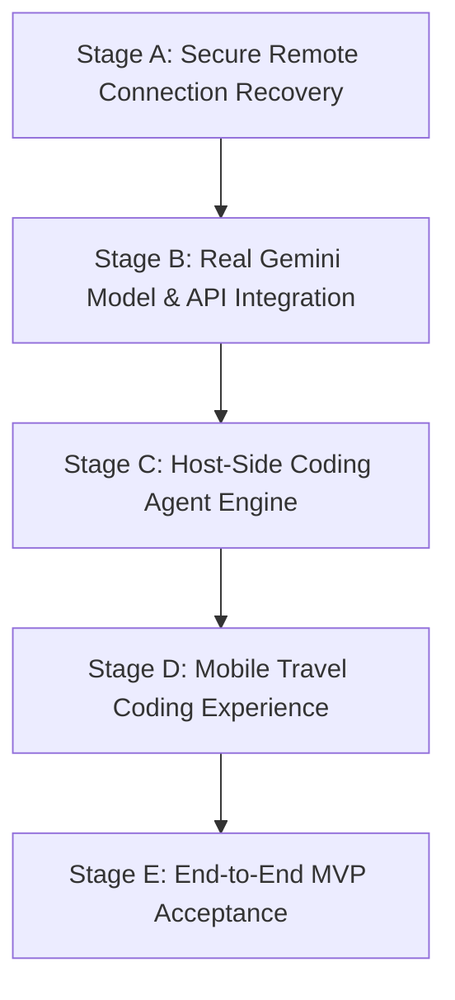

# DEVORBIT — TRAVEL-FIRST AI CODING MVP: MASTER PLAN & EXECUTION ROADMAP

- **Repository**: `https://github.com/shubham230523/DevOrbit`
- **Baseline HEAD SHA**: `54672f28a9b6bdb5b12cc697f00aa8ce16b2e77c`
- **Baseline Branch**: `main`
- **Primary Product Objective**: Mobile-First Remote AI Coding Application
- **Core Principle**: *Gemini is the intelligence, the host computer is the execution environment, and DevOrbit mobile is the remote control.*

---

## 1. Actual Repository Baseline & Git Status

```
Repository URL: git@github.com:shubham230523/DevOrbit.git
Active Branch:  main (up to date with origin/main)
HEAD Commit:    54672f28a9b6bdb5b12cc697f00aa8ce16b2e77c
Working Tree:   Clean (0 uncommitted changes)
```

The codebase is structured as a Go multi-service monorepo with a Flutter mobile application:
- `apps/mobile/`: Flutter client targeting Android and iOS.
- `agents/host-bridge/`: Workstation daemon providing secure workspace access, process execution, Git operations, and ADB discovery.
- `services/connection-broker/`: Opaque WebSocket relay server providing encrypted transport routing between mobile and host.
- `services/control-plane/`: Device pairing, token generation, and machine store.
- `agents/ai-router/`: Multi-provider LLM routing and session manager.
- `agents/acp-adapter/`: Agent Communication Protocol JSON-RPC parser.
- `packages/api-contracts/`: OpenAPI 3.0 specs and schema definitions.

---

## 2. Completed Functionality Relevant to Travel-First MVP

| Component | Implemented Capability | Status | Source Location |
|---|---|---|---|
| **Host Bridge** | Workspace Security Jail (`filepath.EvalSymlinks`) | **IMPLEMENTED AND VERIFIED** | `agents/host-bridge/internal/security/jail.go` |
| **Host Bridge** | Atomic File Storage & SHA256 Conflict Detection | **IMPLEMENTED AND VERIFIED** | `agents/host-bridge/internal/infrastructure/filesystem/storage.go` |
| **Host Bridge** | Binary Command Policy Allowlist (`git`, `gradlew`, `adb`) | **IMPLEMENTED AND VERIFIED** | `agents/host-bridge/internal/security/policy.go` |
| **Host Bridge** | Git Status & Diff Operations | **IMPLEMENTED AND VERIFIED** | `agents/host-bridge/internal/infrastructure/git/client.go` |
| **Host Bridge** | HMAC-SHA256 QR Pairing Challenge & Proof Engine | **IMPLEMENTED AND VERIFIED** | `agents/host-bridge/internal/security/pairing.go` |
| **Host Bridge** | Production Dispatcher without `httptest` (`ResponseWriterBuffer`) | **IMPLEMENTED AND VERIFIED** | `agents/host-bridge/internal/transport/response_buffer.go` |
| **Connection Broker** | Header-Based WSS Auth (`Authorization: Bearer <token>`) | **IMPLEMENTED AND VERIFIED** | `services/connection-broker/internal/broker/broker.go` |
| **Connection Broker** | Fail-Closed Client Token Authorization | **IMPLEMENTED AND VERIFIED** | `services/connection-broker/internal/broker/broker.go` |
| **Connection Broker** | Opaque `FrameEnvelope` Relay (AES-256-GCM Non-Decrypted) | **IMPLEMENTED AND VERIFIED** | `services/connection-broker/internal/broker/broker.go` |
| **Connection Broker** | Device Revocation Teardown | **IMPLEMENTED AND VERIFIED** | `services/connection-broker/internal/broker/broker.go` |
| **Connection Broker** | Strict Origin Policy (`allowedOrigins`) | **IMPLEMENTED AND VERIFIED** | `services/connection-broker/internal/broker/broker.go` |
| **Mobile App** | Flutter AES-256-GCM E2E Session (`FlutterE2ESession`) | **IMPLEMENTED AND VERIFIED** | `apps/mobile/lib/core/security/e2e_session.dart` |
| **Mobile App** | Cross-Language Go ↔ Dart Cryptographic Interoperability | **IMPLEMENTED AND VERIFIED** | `apps/mobile/test/e2e_session_test.dart` |
| **Mobile App** | WSS Broker Client (`BrokerWebSocketClient`) | **IMPLEMENTED AND VERIFIED** | `apps/mobile/lib/core/network/broker_websocket_client.dart` |
| **Mobile App** | Secure Credential Storage (`flutter_secure_storage`) | **IMPLEMENTED AND VERIFIED** | `apps/mobile/lib/core/security/secure_storage.dart` |

---

## 3. Existing Functionality to Reuse

The Travel-First AI Coding MVP will directly reuse 100% of the working security and transport foundation:
1. `WorkspaceJail`: Enforces that all Gemini-initiated file reads, writes, searches, and process executions remain strictly inside the authorized project workspace directory.
2. `StorageEngine`: Provides atomic file creation, file modification with optimistic concurrency SHA256 hash checks, and file deletion.
3. `ProcessRunner`: Executes terminal commands (e.g. `gradlew assembleDebug`, `git status`, `git diff`, `flutter test`) with execution timeouts and process cancellation.
4. `PairingEngine` & `SecureStorage`: Manages single-use QR challenge scanning, HMAC-SHA256 proof confirmation, and secure storage of session tokens and master secrets.
5. `Broker`: Relays opaque AES-256-GCM encrypted frame envelopes over internet WSS connections without access to application plaintext.
6. `FlutterE2ESession`: Handles HKDF SHA-256 directional key derivation and AES-256-GCM encryption/decryption on the phone.

---

## 4. Incomplete & Defective Functionality to Remediate

| Component | Defect / Missing Requirement | Remediation Plan |
|---|---|---|
| **Host Bridge** | Native Gemini API Tool Execution Engine missing | Implement `GeminiAgentEngine` on Host Bridge with native tool calling (`read_file`, `edit_file`, `create_file`, `delete_file`, `execute_command`, `search_files`). |
| **Host Bridge** | Tool Execution Approval Gate missing | Implement human-in-the-loop approval protocol for destructive actions (`edit_file`, `delete_file`, `execute_command`). |
| **Mobile App** | Remote AI Coding Chat UI missing | Replace static dashboard with a travel-first remote control screen featuring streaming response logs, tool execution progress cards, file diff view, approval modal, and cancel button. |
| **Mobile App** | Explicit `session_ready` handshake ACK parser | Ensure `BrokerWebSocketClient` parses server-side `session_ready` frame envelope before marking state active. |
| **AI Router** | Direct Gemini API Key Provisioning | Securely pass Gemini API key from host environment or mobile encrypted session config. |

---

## 5. Explicitly Deferred Scope (Out of MVP)

The following features are **explicitly excluded** from the Travel-First MVP to maintain zero bloat and maximum focus on remote AI coding:
- Full mobile code editor or IDE file tree viewer.
- Android emulator management or remote screen streaming.
- Remote APK installation onto mobile device.
- Mobile APK build dashboard.
- GitHub PR / issue tracker integration.
- Browser-based IDE.
- Multi-host computer management.

---

## 6. Secure Remote Connectivity Architecture

```
Mobile Phone (Travel)                 Connection Broker (Cloud)             Host Machine (Home)
    |                                        |                                       |
    |--- 1. WSS /ws/client (Bearer Token)--->|                                       |
    |                                        |<--- 2. WSS /ws/host (Host Token)------|
    |                                        |                                       |
    |=== 3. Send Encrypted Task Request ====>|                                       |
    |    (Gemini Prompt + Project ID)        |--- 4. Forward Opaque Frame ---------->|
    |                                        |    (Non-decrypted Relay)              |
    |                                        |                                       |
    |                                        |                                 5. Decrypt Request,
    |                                        |                                    Call Gemini API,
    |                                        |                                    Execute Host Tools,
    |                                        |                                    Encrypt Progress/Output,
    |                                        |<--- 6. Stream Encrypted Response -----|
    |<-- 7. Forward Encrypted Response ------|
8. Decrypt & Render Stream
```

---

## 7. Gemini Coding Agent Architecture

### Host-Side Tool Definitions

The Host Bridge exposes 10 native tools to the Gemini API (`google.golang.org/genai` or Gemini REST API):

1. `list_projects`: Lists all discovered projects under allowed workspace roots.
2. `list_files`: Lists directory contents inside the authorized workspace jail.
3. `read_file`: Reads text content and calculates SHA256 hash of a file.
4. `search_files`: Searches file contents across workspace using regex pattern.
5. `create_file`: Creates a new file inside the workspace jail.
6. `edit_file`: Modifies file content with base SHA256 optimistic conflict detection.
7. `delete_file`: Safely removes a file inside workspace jail (requires user approval).
8. `execute_command`: Executes binary allowlist commands (`git`, `gradlew`, `adb`) inside workspace.
9. `get_command_output`: Polls stdout/stderr output logs of long-running commands.
10. `cancel_task`: Cancels active Gemini reasoning loop or process execution.

---

## 8. Mobile User Workflow & UI Layout

The mobile UI is designed as a **remote AI agent control cockpit**:

```
+-------------------------------------------------------------+
| DevOrbit — Remote AI Coding        [Connected (WSS)] [:::] |
+-------------------------------------------------------------+
| Host: Desktop-Workstation (Linux/amd64)                      |
| Active Project: /home/user/projects/DevOrbit [Change]        |
| Model: Gemini 3.8 Flash (Experimental)        [Select]       |
+-------------------------------------------------------------+
| [AI Conversation Stream]                                    |
|                                                             |
| User: Add input validation for pairing challenge payload.    |
|                                                             |
| Gemini: I will inspect pairing_handlers.go and add check.  |
|                                                             |
| [Tool Call Card]                                            |
| > read_file("agents/host-bridge/internal/transport/http...") |
| > [Success: 142 lines read]                                 |
|                                                             |
| [Approval Required Modal]                                   |
| Gemini requests to edit file:                               |
| pairing_handlers.go (+12 lines, -3 lines)                   |
| [View Diff]             [Approve]           [Reject]        |
|                                                             |
+-------------------------------------------------------------+
| [ Prompt Input Text Box...                       ] [Send]   |
+-------------------------------------------------------------+
```

---

## 9. Dependency-Ordered 5-Stage Implementation Plan



### Stage A: Secure Remote Connection Recovery
- **Goal**: Perfect the authenticated WSS connection, `session_ready` ACK, and E2E session recovery.
- **Files Modified**:
  - `services/connection-broker/internal/broker/broker.go`: Send `session_ready` ACK frame upon client WSS connection.
  - `apps/mobile/lib/core/network/broker_websocket_client.dart`: Await `session_ready` ACK frame before setting `authenticatedBrokerSessionActive` state.
- **Verification**: `go test ./...` in `services/connection-broker` and `flutter test` in `apps/mobile`.

### Stage B: Real Gemini Model & API Integration
- **Goal**: Integrate native Gemini API with tool definitions on Host Bridge and AI Router.
- **Files Modified/Created**:
  - `agents/ai-router/internal/router/gemini_provider.go`: [NEW] Gemini API client with function calling definitions.
  - `agents/host-bridge/internal/application/gemini_agent.go`: [NEW] Host-side Gemini agent orchestration service.
- **Verification**: Go unit tests in `agents/ai-router` with mock and live Gemini API responses.

### Stage C: Host-Side Coding Agent Engine
- **Goal**: Wire Gemini function calling directly to `WorkspaceJail`, `StorageEngine`, `ProcessRunner`, and `GitClient`.
- **Files Modified/Created**:
  - `agents/host-bridge/internal/application/agent_tools.go`: [NEW] Implementation of 10 host tools.
  - `agents/host-bridge/internal/transport/broker_client.go`: Route `agent_task` request envelopes to `GeminiAgentEngine`.
- **Verification**: Go E2E tests executing file creation, file edits, and `git status` via agent tool calls.

### Stage D: Mobile Travel Coding Experience
- **Goal**: Build mobile travel control screen in Flutter.
- **Files Modified/Created**:
  - `apps/mobile/lib/features/travel_coding/presentation/travel_coding_screen.dart`: [NEW] Remote cockpit UI.
  - `apps/mobile/lib/features/travel_coding/presentation/widgets/tool_progress_card.dart`: [NEW] Real-time tool log card.
  - `apps/mobile/lib/features/travel_coding/presentation/widgets/approval_dialog.dart`: [NEW] Approval modal.
- **Verification**: Flutter widget tests for `TravelCodingScreen`, `ApprovalDialog`, and stream parser.

### Stage E: End-to-End MVP Acceptance
- **Goal**: Execute full internet travel scenario over real sockets.
- **Verification**:
  - Run full Go integration test suite (`go test ./...`).
  - Run Flutter analysis (`flutter analyze`) and widget tests (`flutter test`).
  - Cross-compile Host Bridge and Connection Broker for Windows (`.exe`) and Linux binaries.
  - Deliver verified acceptance report in `docs/testing/FUNCTIONALITY_1_2_TRAVEL_MVP_REPORT.md`.

---

## 10. Test Matrix & Acceptance Criteria

| Stage | Test Category | Target Component | Command | Acceptance Threshold |
|---|---|---|---|---|
| **A** | Broker WSS Handshake | Connection Broker | `go test -v ./internal/broker/...` | `session_ready` ACK verified |
| **B** | Gemini Tool Calling | AI Router | `go test -v ./internal/router/...` | 10 tool definitions validated |
| **C** | Agent Host Execution | Host Bridge | `go test -v ./tests/e2e/...` | Files edited inside jail |
| **D** | Flutter Travel UI | Mobile App | `flutter test` | All widget & unit tests pass |
| **E** | Full System Integration | Monorepo | `go test ./...` & `flutter analyze` | 100% pass across all 5 modules |

---

## 11. Technical Risk Analysis

| Risk | Impact | Mitigation Strategy |
|---|---|---|
| Cellular network disconnection | Loss of WebSocket frame | `BrokerWebSocketClient` automatically buffers sequence number and resumes upon reconnect. |
| Destructive file overwrite | Code corruption on host | `StorageEngine` checks base SHA256 hash before write; all edits require mobile user approval. |
| Command execution loop | Infinite build loop | `ProcessRunner` enforces strict execution timeouts (default 30s) and cancellation tokens. |

---

## 12. Final Verdict

**FINAL VERDICT: TRAVEL-FIRST MVP PLAN READY**
