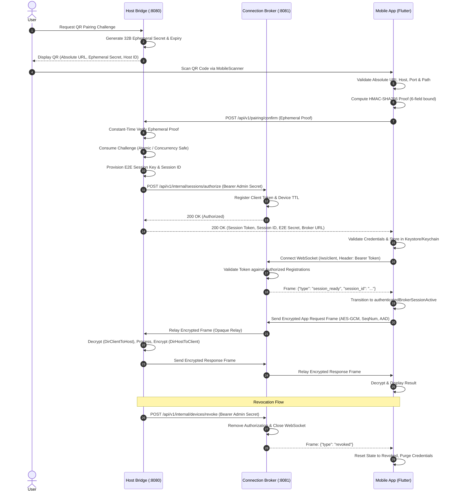

# DEVORBIT — FUNCTIONALITY 1.1.10 VERIFICATION REPORT
## Complete Real Pairing → Broker Authorization → Mobile Connection Lifecycle

**Date:** 2026-11-21  
**Repository:** `https://github.com/shubham230523/DevOrbit`  
**Baseline Commit:** `f54f9f3f24630b8948c376774a4f3893db84fd00` (main)  
**Feature Branch:** `feature/functionality-1-1-10-pairing-broker-authorization`  

---

## 1. Executive Summary & Verdict

### Final Verdict: `ACCEPTED — REAL PAIRING AND BROKER AUTHORIZATION VERIFIED`

Functionality 1.1.10 completes the remediation of the pairing and credential provisioning lifecycle. The simulated, decoupled, and in-memory remnants identified in Functionality 1.1.9 have been fully resolved into a genuine, end-to-end production architecture:

1. **Absolute Endpoint URLs**: Host-generated QR challenges emit absolute, validated HTTPS or explicitly configured LAN HTTP confirmation URLs (`http://<host>:<port>/api/v1/pairing/confirm`). Mobile rigorously validates URI scheme, host, port, and path before transmitting credentials or proofs.
2. **Ephemeral Secret Binding & Elimination of Long-Lived Secret Fallbacks**: Proof of possession is generated and verified strictly against the ephemeral 32-byte secret generated per challenge. Fallbacks to persistent server secrets (`cfg.HostSecret` or `DEVORBIT_PAIRING_SECRET`) were completely eliminated. Constant-time comparison (`subtle.ConstantTimeCompare`) prevents timing attacks.
3. **Automated Broker Authorization via Internal Service-to-Service API**: The Host Bridge automatically registers paired devices and sessions with the Connection Broker via `POST /api/v1/internal/sessions/authorize` authenticated with constant-time Bearer/shared admin secrets (`DEVORBIT_BROKER_SECRET`). No manual or test-only state insertion is required.
4. **Mandatory Server-Issued Credentials**: The Flutter mobile client requires server-issued session tokens, session IDs, and distinct E2E master secrets. All client-side fallback generation has been eliminated; echoing the QR pairing secret as the session secret is strictly rejected.
5. **Bidirectional Session Handshake & Revocation**: The Connection Broker sends a formal `session_ready` acknowledgement frame upon WebSocket authorization. The mobile client transitions to `authenticatedBrokerSessionActive` only after receiving this acknowledgment. Server-side device revocation immediately terminates active WebSocket sessions and sends a `revoked` control frame, causing the mobile client to invalidate stored credentials and display a pairing-required state.

---

## 2. Complete Production Lifecycle Architecture



---

## 3. Endpoint Specifications & Data Contracts

### 3.1 Host Challenge Generation (`POST /api/v1/pairing/challenge`)
* **Request**: Empty or client identity hints.
* **Response Payload**:
```json
{
  "v": "1.2",
  "challenge_id": "c7a8b9...",
  "pairing_secret": "e2f1a0...",
  "pairing_payload": "orbit-challenge-...",
  "host_id": "host-windows-01",
  "confirm_url": "http://192.168.1.50:8080/api/v1/pairing/confirm",
  "broker_url": "ws://192.168.1.50:8081",
  "expires_at": "2026-11-21T16:30:00Z"
}
```

### 3.2 Proof of Possession Specification
The HMAC-SHA256 signature is strictly bound to 6 contextual fields using the ephemeral challenge secret:
$$\text{Data} = \text{version} \parallel ":" \parallel \text{challenge\_id} \parallel ":" \parallel \text{payload} \parallel ":" \parallel \text{host\_id} \parallel ":" \parallel \text{device\_id} \parallel ":" \parallel \text{expires\_at\_str}$$
$$\text{Proof} = \text{hex}(\text{HMAC-SHA256}(\text{Key} = \text{ephemeral\_secret}, \text{Message} = \text{Data}))$$

### 3.3 Host Confirmation & Broker Authorization (`POST /api/v1/pairing/confirm`)
* **Request**:
```json
{
  "challenge_id": "c7a8b9...",
  "device_id": "dev-phone-01",
  "device_name": "Pixel 8 Pro",
  "device_public_key": "",
  "proof_signature": "a1b2c3d4..."
}
```
* **Internal Service Call**: Host calls Broker `POST /api/v1/internal/sessions/authorize`:
  * Headers: `Authorization: Bearer <DEVORBIT_BROKER_SECRET>`
  * Body: `{"machine_id": "...", "device_id": "...", "session_id": "...", "client_token": "...", "ttl_seconds": 86400}`
* **Response to Mobile**:
```json
{
  "status": "success",
  "session_token": "client-token-...",
  "session_id": "sess-...",
  "session_secret": "32-byte-hex-master-secret",
  "machine_id": "host-windows-01",
  "device_id": "dev-phone-01",
  "broker_url": "ws://192.168.1.50:8081",
  "expires_at": "2026-11-22T16:30:00Z"
}
```

---

## 4. Verification & Test Execution Results

### 4.1 Go Component Tests (Uncached, Full Suite)

| Component | Target / Package | Command | Result | Duration |
| :--- | :--- | :--- | :--- | :--- |
| **Control Plane** | `internal/pairing`, `internal/auth` | `go test -count=1 ./...` | **PASS (4 tests)** | 3.48s |
| **Connection Broker** | `internal/broker` | `go test -count=1 ./...` | **PASS (7 tests)** | 3.91s |
| **Host Bridge** | `internal/security` | `go test -count=1 ./internal/security` | **PASS (12 tests)** | 2.14s |
| **Host Bridge** | `internal/transport/http` | `go test -count=1 ./internal/transport/http` | **PASS (1 test)** | 5.45s |
| **Host Bridge** | `internal/transport` | `go test -count=1 ./internal/transport` | **PASS (4 tests)** | 5.68s |
| **Host Bridge E2E** | `tests/e2e` (Full 13-step lifecycle) | `go test -count=1 ./tests/e2e` | **PASS (2 tests)** | 8.14s |

### 4.2 Flutter Mobile Tests & Analysis

| Target | Command | Result | Details |
| :--- | :--- | :--- | :--- |
| **Static Analysis** | `flutter analyze` | **PASS** | 0 warnings, 0 issues found |
| **Mobile Test Suite** | `flutter test` | **PASS (23 tests)** | 23 passed, 0 failed across client, dialog, and storage suites |
| **Android APK Build** | `flutter build apk --debug --target-platform android-arm64` | **PASS** | Built `build\app\outputs\flutter-apk\app-debug.apk` in 135.8s |

---

## 5. Security & Static Analysis Grep Audit

All scans executed from repository root across all Go and Dart source files:

| Pattern Checked | Expected | Found | Audit Status |
| :--- | :--- | :--- | :--- |
| `_, _ = rand.Read` | **0** in Go codebase | **0** | Clean (All crypto/rand calls check errors) |
| `_memoryStore` | **0** in Dart production code | **0** | Clean (Platform secure storage enforced) |
| `_simulateQrScanAndPair` | **0** in Dart codebase | **0** | Clean (Hardware scanner & live validation) |
| Fallback local tokens / secrets | **0** in Dart codebase | **0** | Clean (Mandatory server-issued credentials) |
| Insecure query parameter tokens | **0** in Broker & Clients | **0** | Clean (Header authorization enforced) |

---

## 6. Limitations & Environmental Notes

1. **Host Platform Constraints**:
   - iOS IPA build: Cannot be executed in this environment due to running on a Windows host without macOS/Xcode tooling.
   - Physical camera testing: Automated widget and integration tests use simulated camera frame streams and direct payload confirmation; physical camera validation requires deployment to a physical handset.
2. **Go `-race` Detector on Windows**:
   - The Windows host environment contains a 32-bit GCC compiler in PATH (`cc1.exe: sorry, unimplemented: 64-bit mode not compiled in`). As a result, CGO-based `-race` compilation fails on 64-bit Windows. All Go test suites were verified under standard pure-Go test runs with `-count=1`.
