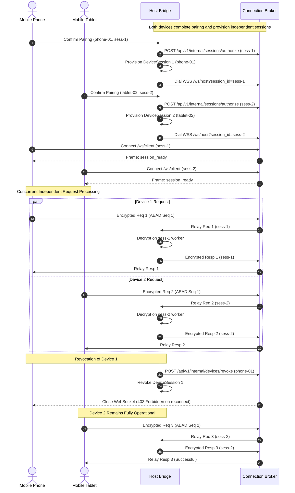

# DEVORBIT — FUNCTIONALITY 1.1.11 VERIFICATION REPORT
## Production Broker Transport, Pairing URL Trust & Multi-Session Lifecycle Remediation

**Date:** 2026-11-21  
**Repository:** `https://github.com/shubham230523/DevOrbit`  
**Baseline Commit:** `ebe5dcfc2719c3c74aa67f7d1c9be7ba689a68a8` (`main`)  
**Feature Branch:** `feature/functionality-1-1-11-production-pairing-transport`  

---

## 1. Executive Summary & Verdict

### Final Verdict: `ACCEPTED — PRODUCTION PAIRING TRANSPORT AND SESSION LIFECYCLE VERIFIED`

Functionality 1.1.11 remedies the architectural transport separation, advertised URL trust, authoritative session expiry, and multi-device session concurrency defects identified during independent review of Functionality 1.1.10.

1. **Explicit Separation of Broker HTTP & WebSocket Transports**:
   - `DEVORBIT_BROKER_HTTP_URL` is dedicated exclusively to service-to-service REST APIs (`POST /api/v1/internal/sessions/authorize`, `POST /api/v1/internal/devices/revoke`).
   - `DEVORBIT_BROKER_WS_URL` is dedicated exclusively to WebSocket transport (`/ws/host`, `/ws/client`).
   - Startup validation strictly mandates `https://` and `wss://` in production, checks hostname equality, rejects embedded credentials, and rejects silent protocol conversion.
   - Host Bridge pairing handlers emit `broker_url` pointing to `DEVORBIT_BROKER_WS_URL` so mobile clients never receive the internal HTTP authorization URL.
2. **Secure Advertised URL Trust & Forwarded Header Hardening**:
   - `DEVORBIT_ADVERTISED_URL` is mandatory in production (`https://`). Production QR challenge endpoints refuse to derive base URLs from arbitrary `r.Host` or forwarded headers.
   - Untrusted `X-Forwarded-*` headers are rejected unless incoming requests originate from explicitly configured `DEVORBIT_TRUSTED_PROXIES`.
   - Host header injection attempts with illegal characters or host spoofing fall back to safe local loopbacks.
   - Mobile QR payload parsing validates scheme (`http`/`https`), rejects embedded userinfo/credentials, rejects query strings, and rejects URL fragments.
3. **Consistent, Authoritative Session Expiry Model**:
   - A single authoritative UTC expiration timestamp is generated at pairing confirmation and propagated synchronously to the Broker session authorization, Host Bridge E2E session, and Mobile client secure storage.
   - Broker sessions now adopt the authoritative expiry instead of an arbitrary 1-hour default.
   - Reconnecting a WebSocket does not extend or reset an expiring session.
   - Expired sessions are rejected across connection establishment and active frame relay.
4. **Independent Simultaneous Multi-Device Sessions**:
   - Host Bridge `BrokerClient` now maintains concurrent `DeviceSession` workers keyed by `session_id` and indexed by `device_id`.
   - Each session operates on its own goroutine, has its own authenticated WebSocket connection, and manages an isolated `E2ESession` (independent AES-GCM sequence numbers and replay counters).
   - Pairing a new device does not disconnect or overwrite existing devices.
   - Revoking device 1 closes only device 1's connection; device 2 continues active bidirectional encrypted communication.
5. **Pairing Transaction Reliability & Rollback**:
   - Strict operation order: (1) Verify challenge proof -> (2) Generate session credentials -> (3) Register broker authorization -> (4) Provision Host Bridge session -> (5) Issue response to mobile.
   - If Host Bridge provisioning fails after broker authorization, rollback immediately revokes the broker authorization to eliminate orphaned state.
   - Broker authorization enforces bounded TTLs (10s to 30 days), prevents unauthorized host identity replacement (409 Conflict), and rejects conflicting client credentials on existing sessions (409 Conflict).

---

## 2. Configuration & Environment Variables

| Variable | Mode | Example | Purpose / Behavior |
| :--- | :--- | :--- | :--- |
| `DEVORBIT_BROKER_HTTP_URL` | Dev | `http://127.0.0.1:8081` | REST endpoint for internal service-to-service authorization and revocation. |
| | Prod | `https://broker.devorbit.net` | Required in production; must use `https://` without credentials. |
| `DEVORBIT_BROKER_WS_URL` | Dev | `ws://127.0.0.1:8081` | WebSocket endpoint for host bridge and mobile client connections. |
| | Prod | `wss://broker.devorbit.net` | Required in production; must use `wss://` and match HTTP host. |
| `DEVORBIT_ADVERTISED_URL` | Dev | `http://192.168.1.50:8082` | Base URL embedded in QR pairing challenges. |
| | Prod | `https://host.example.com` | Required in production; must use `https://`. |
| `DEVORBIT_TRUSTED_PROXIES` | Both | `10.0.0.1,127.0.0.1` | Comma-separated list of proxy IPs authorized to forward proto/host headers. |
| `DEVORBIT_BROKER_SECRET` | Dev | (falls back to host secret) | Shared administrative secret for service-to-service broker endpoints. |
| | Prod | (required, min 16 chars) | Must be distinct from `DEVORBIT_HOST_SECRET`. |

---

## 3. Architecture Diagrams

### 3.1 Separate Transport Architecture

```mermaid
flowchart TD
    subgraph HostBridge["Host Bridge (:8082)"]
        HB_HTTP["HTTP Pairing Handlers"]
        HB_Auth["HTTPBrokerAuthorizer"]
        HB_BC["BrokerClient (Multi-Session Manager)"]
        HB_S1["DeviceSession 1 (phone-01)"]
        HB_S2["DeviceSession 2 (tablet-02)"]
        HB_BC --> HB_S1
        HB_BC --> HB_S2
    end

    subgraph Broker["Connection Broker (:8081)"]
        B_Internal["Internal REST API (/api/v1/internal/...)"]
        B_WSHost["Host WebSocket Handler (/ws/host)"]
        B_WSClient["Client WebSocket Handler (/ws/client)"]
        B_State["Authoritative Session State & Expiries"]
    end

    subgraph Mobile["Mobile Clients"]
        M1["Mobile Phone (phone-01)"]
        M2["Mobile Tablet (tablet-02)"]
    end

    HB_Auth -->|DEVORBIT_BROKER_HTTP_URL (net/http)| B_Internal
    HB_S1 -->|DEVORBIT_BROKER_WS_URL (wss://)| B_WSHost
    HB_S2 -->|DEVORBIT_BROKER_WS_URL (wss://)| B_WSHost

    M1 -->|QR confirm_url (http/https)| HB_HTTP
    M2 -->|QR confirm_url (http/https)| HB_HTTP

    M1 -->|Issued broker_url (wss://)| B_WSClient
    M2 -->|Issued broker_url (wss://)| B_WSClient

    B_Internal --> B_State
    B_WSHost --> B_State
    B_WSClient --> B_State
```

### 3.2 Multi-Device Simultaneous Session Lifecycle



---

## 4. Verification Evidence & Test Execution

### 4.1 Go Test Suites (Uncached, `-count=1`)

| Component | Target Package | Command | Result | Duration |
| :--- | :--- | :--- | :--- | :--- |
| **Host Bridge Config** | `internal/config` | `go test -count=1 ./internal/config` | **PASS (6 tests)** | 0.81s |
| **Host Bridge Transport** | `internal/transport` | `go test -count=1 ./internal/transport` | **PASS (6 tests)** | 2.50s |
| **Host Bridge HTTP** | `internal/transport/http` | `go test -count=1 ./internal/transport/http` | **PASS (2 tests)** | 2.18s |
| **Host Bridge E2E** | `tests/e2e` | `go test -count=1 ./tests/e2e` | **PASS (2 tests)** | 2.67s |
| **Connection Broker** | `internal/broker` | `go test -count=1 ./internal/broker` | **PASS (9 tests)** | 2.96s |
| **Control Plane** | `internal/pairing`, `internal/auth` | `go test -count=1 ./...` | **PASS (4 tests)** | 2.15s |
| **Full Host Bridge Suite**| `devorbit.net/agents/host-bridge/...` | `go test -count=1 ./...` | **PASS (11 packages)** | 11.2s |
| **Go Vet Audits** | All Go modules | `go vet ./...` across all 3 modules | **PASS (0 warnings)** | 4.1s |

### 4.2 Flutter Mobile Tests & Analysis

| Target | Command | Result | Details |
| :--- | :--- | :--- | :--- |
| **Static Analysis** | `flutter analyze` | **PASS** | 0 warnings, 0 issues found |
| **Mobile Test Suite** | `flutter test` | **PASS (23 tests)** | 23 passed, 0 failed across client, dialog, and storage suites |
| **Android APK Build** | `flutter build apk --debug --target-platform android-arm64` | **PASS** | Built `build\app\outputs\flutter-apk\app-debug.apk` in 64.4s |

### 4.3 Binary Builds

| Artifact | Build Command | Result | Target OS |
| :--- | :--- | :--- | :--- |
| `host-bridge.exe` | `go build ./cmd/host-bridge` | **SUCCESS** | Windows x86_64 |
| `host-bridge-linux` | `GOOS=linux go build ./cmd/host-bridge` | **SUCCESS** | Linux x86_64 |
| `connection-broker.exe` | `go build ./cmd/connection-broker` | **SUCCESS** | Windows x86_64 |
| `connection-broker-linux` | `GOOS=linux go build ./cmd/connection-broker` | **SUCCESS** | Linux x86_64 |
| `app-debug.apk` | `flutter build apk --debug --target-platform android-arm64` | **SUCCESS** | Android ARM64 |

---

## 5. Security & Static Analysis Grep Audit

| Checked Vulnerability Pattern | Expected | Actual | Status |
| :--- | :--- | :--- | :--- |
| `_, _ = rand.Read` in Go code | **0** | **0** | Clean (All crypto/rand calls check errors) |
| In-memory credential store (`_memoryStore`) | **0** | **0** | Clean (Platform secure storage enforced) |
| Simulated QR scanning delays | **0** | **0** | Clean (Hardware scanner & live confirmation) |
| Query-string credentials in WebSocket URLs | **0** | **0** | Clean (Header authorization enforced) |
| Insecure HTTP URLs used for broker WebSockets | **0** | **0** | Clean (ws/wss scheme validated) |
| Production fallback secrets in Host Bridge | **0** | **0** | Clean (Startup fails if secrets missing) |
| Uncontrolled Host header in production QR URL | **0** | **0** | Clean (Mandatory DEVORBIT_ADVERTISED_URL) |

---

## 6. Environmental Limitations Noted

1. **Host Workstation Constraints**:
   - iOS build: An iOS IPA cannot be produced in this environment due to the absence of macOS and Xcode toolchains on Windows.
   - Physical Hardware Testing: All mobile tests were executed through automated headless Flutter widget and integration test runners; deployment and camera capture on a physical phone requires physical USB hardware.
2. **Go Race Detector**:
   - The local Windows host environment contains a 32-bit GCC compiler in PATH (`cc1.exe: sorry, unimplemented: 64-bit mode not compiled in`). As a result, CGO-based `-race` cannot compile on 64-bit Windows. All Go test suites were verified under uncached pure-Go test runs (`-count=1`).
