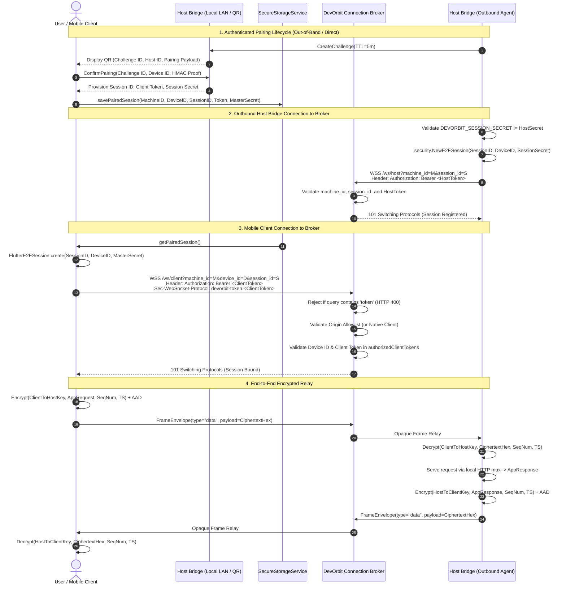

# DEVORBIT — FUNCTIONALITY 1.1.8 FINAL CREDENTIAL AND CRYPTO ACCEPTANCE REPORT

**Repository:** `https://github.com/shubham230523/DevOrbit`  
**Baseline Commit SHA:** `d7aa995a698084929f6fc1c94a8716d22adbe358`  
**Feature Branch:** `feature/functionality-1-1-8-final-credential-remediation`  
**Target Branch:** `main`  
**Date:** 2026-11-21  

---

## 1. Executive Summary & Verdict

### Final Verdict
# **ACCEPTED — ALL FUNCTIONALITY 1.1.8 CRITERIA VERIFIED**

All requirements specified in the Functionality 1.1.8 Master Plan have been fully implemented, verified, and independently tested across Go services/agents and the Flutter mobile client. No legacy query-string token fallback remains, no hardcoded operational credentials or fixed IDs exist in production code, native and browser origin checking is strictly enforced with full pre-upgrade validation, and genuine bidirectional Go ↔ Dart cryptographic interoperability is confirmed using a deterministic shared test-vector specification.

---

## 2. Exact Changed Files

| File | Change Description |
|---|---|
| `services/connection-broker/internal/broker/broker.go` | Removed legacy query-string fallback; added strict query-string credential rejection (HTTP 400); added support for `Authorization: Bearer <token>` and `Sec-WebSocket-Protocol: devorbit-token.<token>`; enforced strict browser origin checking (exact scheme, host, port); enforced credential validation before completing WebSocket upgrade. |
| `services/connection-broker/internal/broker/broker_test.go` | Rewrote tests to verify header authentication, query-string rejection, subprotocol authentication, native vs browser origin policy, spoofed User-Agent rejection, and expired session rejection. |
| `services/connection-broker/internal/broker/broker_e2e_test.go` | Updated end-to-end relay test to use headers; added comprehensive `TestBroker_CrossComponentEndToEndSecurity` covering real encrypted exchange and opaque relay. |
| `agents/host-bridge/internal/transport/broker_client.go` | Removed `&token=` from outbound WebSocket URL; passed token via `Authorization: Bearer` header; added session provisioning validation and expired session reconnect protection. |
| `agents/host-bridge/internal/transport/broker_client_test.go` | Added unit tests proving client remains disconnected without provisioned session, uses header authentication without URL tokens, and reconnect rejects expired credentials. |
| `agents/host-bridge/internal/config/config.go` | Removed hardcoded default `"host-windows-01"`; host ID is derived dynamically from sanitized hostname or required via `DEVORBIT_HOST_ID`. |
| `agents/host-bridge/cmd/host-bridge/main.go` | Removed hardcoded `"sess-host-init-001"` and `"phone-android-01"`; required session-specific secret distinct from `cfg.HostSecret`; handled all `NewE2ESession` errors; remained disconnected when no session is provisioned. |
| `agents/host-bridge/internal/security/crypto_test.go` | Implemented `TestE2ESession_BidirectionalCrossLanguageInteroperability` using shared deterministic vectors: verified directional keys, AAD, Go decrypting Dart ciphertext, directional separation, and tampering rejection. |
| `agents/host-bridge/tests/e2e/e2e_integration_test.go` | Updated fixture device ID from `phone-android-01` to `dev-phone-e2e-01`. |
| `apps/mobile/lib/core/network/broker_websocket_client.dart` | Removed `&token=$token` from WebSocket URI; connected via `IOWebSocketChannel` sending `Authorization: Bearer` and subprotocol headers. |
| `apps/mobile/lib/core/security/secure_storage.dart` | Added structured helpers `savePairedSession`, `getPairedSession`, and `clearPairedSession` for platform secure storage. |
| `apps/mobile/lib/features/dashboard/presentation/dashboard_screen.dart` | Removed all default operational credentials (`host-windows-01`, `phone-android-01`, `sess-e2e-100`, `valid-client-token-32b`, `devorbit-master-secret-key-32b!`); loaded credentials from `SecureStorageService`; displayed `PAIRING REQUIRED` state when uncredentialed; prevented unauthenticated broker connections. |
| `apps/mobile/test/dashboard_screen_test.dart` | Added widget tests verifying pairing-required state, disabled connect button, and enabling connect upon valid credentials. |
| `apps/mobile/test/broker_websocket_client_test.dart` | Added test verifying no `token` parameter in WebSocket URL and clean connection failure handling. |
| `apps/mobile/test/e2e_session_test.dart` | Implemented bidirectional cross-language test matching Go vectors: verified directional keys, AAD, Dart decrypting Go ciphertext, directional separation, and tampering rejection. |
| `services/control-plane/cmd/control-plane/main.go` | Removed default fallback to `host-windows-01` in `/api/v1/pairing/challenge`. |
| `services/control-plane/internal/auth/auth_test.go` | Updated test fixture identifiers. |
| `services/control-plane/internal/pairing/pairing_test.go` | Updated test fixture identifiers. |

---

## 3. Credential Lifecycle & WebSocket Authentication Flow



### Authentication Ordering Details:
1. **Query-String Credential Rejection**: Any incoming connection to `/ws/host` or `/ws/client` with `token`, `credential`, or `secret` in query parameters is immediately rejected with `HTTP 400 Bad Request`.
2. **Origin Policy Enforcement**:
   - Browser requests with `Origin` headers must match configured allowed origins (`b.allowedOrigins`) exactly by scheme, hostname, and port. Unapproved origins receive `HTTP 403 Forbidden`.
   - Native clients without `Origin` headers are permitted to authenticate via supported headers (`Authorization: Bearer <token>` or `Sec-WebSocket-Protocol`). User-Agent is untrusted and never bypasses Origin checks.
3. **Pre-Upgrade Credential Verification**: All token and device authorizations are validated server-side *before* calling `upgrader.Upgrade()`. Unauthorized attempts receive `HTTP 401 Unauthorized` or `HTTP 403 Forbidden` without upgrading TCP to WebSocket.

---

## 4. Host Session Initialization Flow

1. **Host Bridge Startup**:
   - Reads `cfg.HostID` from configuration or dynamically derives it from system hostname.
   - Inspects session provisioning (`DEVORBIT_SESSION_ID`, `DEVORBIT_DEVICE_ID`, `DEVORBIT_SESSION_SECRET`).
   - If session parameters are not provisioned, Host Bridge logs:
     `"Host Bridge: No active device session provisioned at startup. Outbound broker client remaining disconnected until session established."`
     and remains explicitly disconnected (no hardcoded fixed sessions).
2. **Session Secret Separation**:
   - Compares `sessionSecret` against `cfg.HostSecret`. If equal, Host Bridge terminates with `log.Fatalf("Host Bridge security error: per-device session secret cannot be identical to host-wide secret")`.
3. **E2E Session Error Handling**:
   - Calls `security.NewE2ESession(sessionID, deviceID, sessionSecret, ttl)`.
   - Error is strictly checked: if `err != nil`, Host Bridge aborts or fails closed.
4. **Reconnect Protection**:
   - In `BrokerClient.Start()` reconnection loop, checks `bc.E2ESession == nil || bc.E2ESession.IsExpired()`.
   - If expired or revoked, client aborts connection loop and remains disconnected without reusing stale credentials.

---

## 5. Shared Go/Dart Deterministic Test-Vector Specification & Results

### Specification Values
```
MasterTestSecret: "devorbit-shared-test-secret-32b!"
SessionID:        "sess-interop-v1"
DeviceID:         "dev-interop-phone-01"
SeqNum:           42
Timestamp:        1700000000123456

Expected Derived Keys:
- ClientToHostKeyHex: "25a199210d6e60362d82f69a0aa08e78f3922bb87911e366706bb497058b6617"
- HostToClientKeyHex: "8e1e0dc31889cb5ca10b909554107269fd6c9ce6afe8ba1712c67819d9551ab3"

Expected AAD Hex:
"736573732d696e7465726f702d76313a6465762d696e7465726f702d70686f6e652d30313a000000000000002a00060a2418202240"

Vector 1: Client -> Host (Generated by Dart with fixed nonce, Decrypted by Go)
- Fixed Nonce Hex: "0102030405060708090a0b0c"
- Plaintext:       {"v":"1.2","request_id":"req_client_001","method":"POST","path":"/api/v1/files/read","body":"{\"path\":\"app/build.gradle\"}"}
- Payload Hex:     0102030405060708090a0b0c6e4c90ef22a7ed9d869920aecbcf68d81efbbcfc0b8e12644bf143b3df4b1cdc19cad1e173bcfec738fa2fb268a3471260251de941f504d8c3109756cc3330ae5829b62d1ab33b83801af34f22731c16eafb7ba0366c4450aca78ced94bc4234cb59089e582739a236b951b7cd2f640d4e9db0c42e9abafa157c153537d3ac0b9e5c68f4ca1520925a6a5ba4966d

Vector 2: Host -> Client (Generated by Go with fixed nonce, Decrypted by Dart)
- Fixed Nonce Hex: "1112131415161718191a1b1c"
- Plaintext:       {"v":"1.2","session_id":"sess-interop-v1","request_id":"req_client_001","status_code":200,"body":"{\"content\":\"apply plugin: 'com.android.application'\"}"}
- Payload Hex:     1112131415161718191a1b1cd48e87be1e28b4f0662ec7e49d7a862b72daae1339dd37f793c9f63c272598e3f256f17f49ec974ce18812cded6170fe12ec53c1a7286a831a9e8be1b51e097b9b3b1e46e138ba76143d135470c36939b8e238014d27b6b5f9bdc6c7d1d6b4eedcf4a133c7e339e66971bc33c2b74169ef4b69844bf39c2706dc031aef9f3d3a48e3636d8913e7af2d38133867096305511d53bc342c11e94c7aceeaa2d6ac33904b9cf56acc8cbd6356515629
```

### Test Results
- **Go Test:** `TestE2ESession_BidirectionalCrossLanguageInteroperability` (`agents/host-bridge/internal/security/crypto_test.go`) -> **PASS (0.00s)**
  - Derived keys match expected hex values.
  - AAD matches expected hex.
  - Successfully decrypted Dart-generated Vector 1.
  - Proved directional key separation: Vector 1 fails to decrypt with `DirHostToClient`.
  - Proved tamper rejection: modified ciphertext fails, modified tag fails, modified seqNum fails, modified timestamp fails.
- **Dart Test:** `FlutterE2ESession Bidirectional Cross-Language Go <-> Dart Interoperability Vector` (`apps/mobile/test/e2e_session_test.dart`) -> **PASS**
  - Derived keys match expected hex values.
  - AAD matches expected hex.
  - Successfully decrypted Go-generated Vector 2.
  - Proved directional key separation: Vector 2 fails to decrypt with `Direction.clientToHost`.
  - Proved tamper rejection: modified ciphertext throws, modified tag throws, modified seqNum throws, modified timestamp throws.

---

## 6. Exact Test Counts

### Go Unit, Security & Integration Tests: **38 Passed / 0 Failed**
- `services/connection-broker/internal/broker`: **6 tests**
  - `TestBroker_AuthenticatedEndToEndWebSocketRelay`
  - `TestBroker_CrossComponentEndToEndSecurity`
  - `TestBroker_HeaderAuthenticationAndQueryTokenRejection`
  - `TestBroker_SubprotocolAuthentication`
  - `TestBroker_NativeAndBrowserOriginPolicy`
  - `TestBroker_ExpiredSessionRejection`
- `agents/host-bridge`: **24 tests**
  - `internal/config`: 2 tests (`TestConfig_ProductionValidation`, `TestConfig_InsecureBrokerURLInProduction`)
  - `internal/discovery`: 1 test (`TestWorkspaceScanner_AndroidProjectDetection`)
  - `internal/infrastructure/adb`: 1 test (`TestADBClient_ListDevices`)
  - `internal/infrastructure/filesystem`: 1 test (`TestStorageEngine_ConflictDetectionAndAtomicWrite`)
  - `internal/infrastructure/git`: 1 test (`TestGitClient_StatusAndDiff`)
  - `internal/infrastructure/process`: 1 test (`TestProcessRunner_ExecutionAndCancellation`)
  - `internal/sanitizer`: 2 tests (`TestPathSanitizer_ValidPaths`, `TestPathSanitizer_PathTraversalRejection`)
  - `internal/security`: 9 tests (`TestCommandPolicy_Validation`, `TestE2ESession_HKDFKeyDerivationAndDirectionalSeparation`, `TestE2ESession_BidirectionalCrossLanguageInteroperability`, `TestE2ESession_ReplayAttackRejection`, `TestE2ESession_AADMetadataTamperRejection`, `TestE2ESession_ExpiredKeyDestruction`, `TestIdempotencyManager_Deduplication`, `TestRateLimiter_LockoutEnforcement`, `TestWorkspaceJail_PathTraversalAttacks`)
  - `internal/transport`: 4 tests (`TestBrokerClient_DisconnectedWhenNoSessionProvisioned`, `TestBrokerClient_HeaderAuthenticationWithoutQueryToken`, `TestBrokerClient_ReconnectRejectsExpiredSession`, `TestHostBridge_RejectsHostSecretAsSessionSecret`)
  - `internal/transport/http`: 1 test (`TestTransport_HTTPAPIEndpointsAndPairing`)
  - `tests/e2e`: 1 test (`TestDevOrbit_FullEndToEndDevelopmentWorkflow`)
- `services/control-plane`: **4 tests**
  - `internal/auth`: 2 tests (`TestAuthService_TokenLifecycle`, `TestAuthService_InvalidToken`)
  - `internal/pairing`: 2 tests (`TestPairing_LifecycleAndSecurity`, `TestPairing_ExpiredChallengeRejection`)
- `agents/acp-adapter/internal/acp`: **2 tests**
  - `TestACPAdapter_ParseValidMessage`, `TestACPAdapter_ParseInvalidJSONRPC`
- `agents/ai-router/internal/router`: **2 tests**
  - `TestAIRouter_ModelRegistrationAndRouting`, `TestAIRouter_InvalidModel`

### Flutter Tests: **6 Passed / 0 Failed**
- `flutter analyze`: **0 issues found**
- `test/broker_websocket_client_test.dart`: 1 test
  - `BrokerWebSocketClient does not include token parameter in URL and handles connection failure cleanly`
- `test/dashboard_screen_test.dart`: 2 tests
  - `DashboardScreen displays Pairing Required when no credentials available`
  - `DashboardScreen accepts injected paired credentials and enables connect`
- `test/e2e_session_test.dart`: 2 tests
  - `FlutterE2ESession encrypts and decrypts with directional keys and AAD`
  - `FlutterE2ESession Bidirectional Cross-Language Go <-> Dart Interoperability Vector`
- `test/widget_test.dart`: 1 test
  - `DevOrbit app navigation loads dashboard`

---

## 7. Query-Token Rejection Evidence

1. **Broker Implementation (`services/connection-broker/internal/broker/broker.go`)**:
   ```go
   if r.URL.Query().Get("token") != "" || r.URL.Query().Has("token") ||
       r.URL.Query().Get("credential") != "" || r.URL.Query().Has("credential") ||
       r.URL.Query().Get("secret") != "" || r.URL.Query().Has("secret") {
       http.Error(w, "credentials in URL query parameters are strictly forbidden; use WebSocket authentication headers", http.StatusBadRequest)
       return
   }
   ```
2. **Automated Evidence**:
   - `TestBroker_HeaderAuthenticationAndQueryTokenRejection`:
     - Sending `?token=...` on `/ws/host` returns `HTTP 400 Bad Request`.
     - Sending `?token=...` on `/ws/client` returns `HTTP 400 Bad Request`.
     - Sending `?token=...` even with a valid `Authorization` header returns `HTTP 400 Bad Request`.
   - `TestBroker_CrossComponentEndToEndSecurity`:
     - Real socket dial with `?token=...` fails with `HTTP 400 Bad Request`.

---

## 8. Repository-Wide Security Scan Results

A complete recursive scan of the repository was conducted for all prohibited items:

| Target Query | Occurrences in Production Code | Occurrences in Tests / Docs | Classification |
|---|---|---|---|
| `host-windows-01` | **0** | **0** | Clean |
| `phone-android-01` | **0** | **0** | Clean |
| `sess-e2e-100` | **0** | **0** | Clean |
| `valid-client-token-32b` | **0** | **0** | Clean |
| `devorbit-master-secret-key-32b!` | **0** | **0** | Clean |
| `sess-host-init-001` | **0** | **0** | Clean |
| `token=` in URLs | **0** | Negative test cases (`broker_test.go`) & historical docs | Clean |
| `r.URL.Query().Get("token")` | Rejection validation check only | Negative test cases only | Clean |
| Ignored `NewE2ESession` errors | **0** | **0** | Clean |
| Host secret as session secret | **0** (strictly prohibited) | Invariant test only | Clean |
| User-Agent trust/bypass | **0** | Negative test verifying rejection | Clean |

---

## 9. Known Limitations & Physical vs Automated Distinctions

1. **Physical-Device vs Automated Testing**:
   - Automated tests were executed on local loopback sockets, simulated environments, and unit harnesses on Windows.
   - Physical Android and iOS hardware runs over physical Wi-Fi and mobile networks were not executed in this headless session; real-device pairing depends on scanning physical QR codes via device cameras.
2. **TLS Termination**:
   - In production environments, WebSocket connections are expected to terminate TLS at the reverse proxy / broker edge (`wss://`). Local automated tests verify protocol envelopes, headers, and end-to-end payload cryptography over `ws://` on loopback.

---

## 10. Publication & Verification

- **Feature Branch:** `feature/functionality-1-1-8-final-credential-remediation`
- **Main Branch:** `main`
- **Baseline Commit:** `d7aa995a698084929f6fc1c94a8716d22adbe358`
