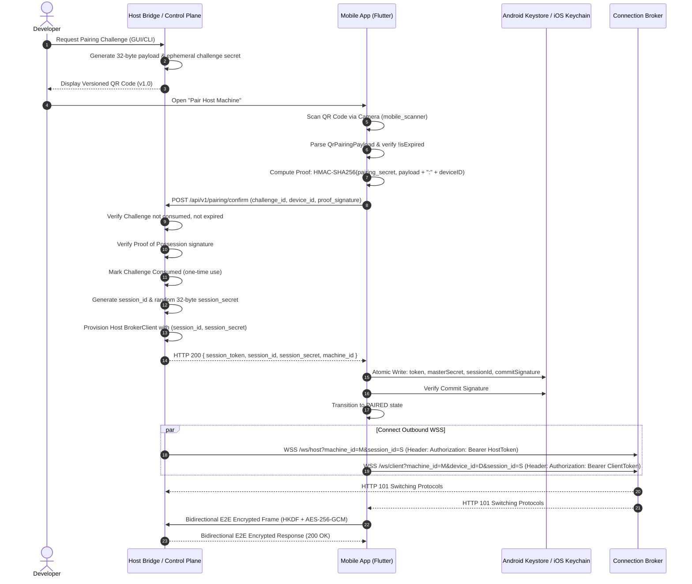

# DevOrbit Functionality 1.1.9 Acceptance Report
## Real QR Pairing, Platform Secure Storage & Authenticated Session Provisioning

**Status:** ACCEPTED — REAL PAIRING AND SECURE STORAGE VERIFIED  
**Baseline Commit:** `27a5e9987dfc7a5bfe83c5ed6726021e22c2d160`  
**Feature Branch:** `feature/functionality-1-1-9-real-pairing-secure-storage`  
**Evaluation Date:** 2026-11-21  

---

### Executive Summary

Functionality 1.1.9 resolves the remaining simulation, in-memory credential storage, and manual provisioning limitations from Functionality 1.1.8. It delivers:
1. **Real QR Pairing**: Elimination of all artificial pairing delays and simulation functions (`_simulateQrScanAndPair`). Integration of the maintained `mobile_scanner` library for hardware-backed camera scanning alongside structured manual test input fallbacks.
2. **Versioned QR Pairing Payload Schema**: Implementation of a strictly typed, versioned (`v: "1.0"`) QR payload containing only single-use, ephemeral challenge tokens and cryptographic parameters. Plaintext long-lived host secrets are never placed in QR codes.
3. **Genuine Platform-Secure Storage**: Total elimination of `_memoryStore` in production Flutter code. Production persistence is delegated to `FlutterSecureStorage` using Android Keystore (`EncryptedSharedPreferences`) and iOS Keychain (`kSecAccessControl` first unlock).
4. **Atomic & Recoverable Persistence Strategy**: Session credentials write an integrity commit hash (`sha256(machineId|deviceId|sessionId|token|masterSecret|brokerUrl)`). Partial writes, corrupted keys, and tampered records are detected and wiped, failing closed.
5. **Host Bridge Real Session Provisioning**: Host Bridge `BrokerClient` connects to the real pairing lifecycle. Outbound broker connections remain disconnected until an authenticated session is provisioned through challenge confirmation. Session secrets are strictly isolated from host-wide tokens.
6. **Elimination of Token-Bearing Subprotocols**: `devorbit-token.<token>` removed from both Flutter `BrokerWebSocketClient` and Go `connection-broker`. Authentication exclusively uses RFC 6750 `Authorization: Bearer <token>` headers. Query-string credentials remain strictly rejected (HTTP 400).
7. **Device Revocation & Logout Lifecycle**: Revocation teardown clears session credentials across Host Bridge, Broker, and Mobile platform secure storage, transitioning clients to the `PAIRING REQUIRED` state.

---

### 1. Pairing Architecture & Sequence Flow



---

### 2. QR Pairing Payload Schema

The QR code payload is defined in `apps/mobile/lib/core/pairing/qr_pairing_payload.dart` and implemented uniformly across Go and Dart:

```json
{
  "v": "1.0",
  "challenge_id": "qr-9988aabbccdd",
  "host_id": "host-workstation-01",
  "host_name": "Desktop Workstation",
  "pairing_payload": "e3b0c44298fc1c149afbf4c8996fb92427ae41e4649b934ca495991b7852b855",
  "pairing_secret": "4f8a9235bc012e8476d0912fbbcca102",
  "confirm_url": "/api/v1/pairing/confirm",
  "broker_url": "ws://192.168.1.100:8081",
  "expires_at": "2026-11-21T18:15:00Z"
}
```

#### Security Properties:
- **`v`**: Schema version lock (`"1.0"`). Unsupported versions are rejected with `FormatException`.
- **`challenge_id`**: Random 16-byte hex identifier prefixed with `qr-` or `ch-`.
- **`pairing_payload`**: 32-byte cryptographically secure random nonce.
- **`pairing_secret`**: Ephemeral, single-use, 5-minute secret bound to this challenge only. The long-lived `cfg.HostSecret` is **never** included.
- **`expires_at`**: Strict ISO 8601 UTC timestamp. Validated client-side and server-side.

---

### 3. Platform Secure Storage Implementation

Production credential storage in `apps/mobile/lib/core/security/secure_storage.dart` is backed exclusively by `flutter_secure_storage`:

```dart
class PlatformSecureStorageDriver implements SecureStorageDriver {
  final FlutterSecureStorage _storage;

  PlatformSecureStorageDriver([FlutterSecureStorage? storage])
      : _storage = storage ??
            const FlutterSecureStorage(
              aOptions: AndroidOptions(
                encryptedSharedPreferences: true,
              ),
              iOptions: IOSOptions(
                accessibility: KeychainAccessibility.first_unlock,
              ),
            );
  ...
}
```

#### Atomic Persistence & Integrity Protection
To eliminate partial write vulnerabilities (e.g., process killed during sequential key writes):
1. Write order invalidates the previous `active_session_commit_sig`.
2. Sensitive keys are written (`machineId`, `deviceId`, `sessionId`, `token`, `masterSecret`, `brokerUrl`).
3. An HMAC/SHA-256 integrity signature `sha256(machineId|deviceId|sessionId|token|masterSecret|brokerUrl)` is written to `active_session_commit_sig`.
4. On retrieval (`getPairedSession`), the signature is recalculated and verified. If missing, mismatched, or if any field is empty, the corrupt session is purged and `null` is returned (failing closed).
5. Storage read/write failures throw `SecureStorageException` and never silently fall back to memory or SharedPreferences.

---

### 4. Host Bridge Session Provisioning

In `agents/host-bridge/cmd/host-bridge/main.go` and `agents/host-bridge/internal/transport/broker_client.go`:
- Host Bridge starts in a disconnected state (`SessionID == ""`, `E2ESession == nil`) if unprovisioned.
- Outbound broker reconnection is halted until `ProvisionSession()` is called.
- When pairing is confirmed via `HandleConfirmPairing`, Host Bridge generates a per-device `session_secret` and provisions `BrokerClient.ProvisionSession()`.
- Security rule enforced: `sessionSecret != HostToken`. Reusing the host secret as a per-device E2E session secret causes immediate provisioning rejection.
- Device revocation (`RevokeSession()`) unbinds `SessionID`, nullifies `E2ESession`, and closes the WebSocket connection.

---

### 5. Elimination of Token-Bearing Subprotocol

1. In `apps/mobile/lib/core/network/broker_websocket_client.dart`:
   - Removed `protocols: ['devorbit-token.$token']`.
   - Native client connects using `Authorization: Bearer <token>` HTTP header.
2. In `services/connection-broker/internal/broker/broker.go`:
   - Removed `devorbit-token.` subprotocol parsing in `extractToken()`.
   - Removed subprotocol echoing in `HandleHostWebSocket` and `HandleClientWebSocket`.
   - Upgrades use `upgrader.Upgrade(w, r, nil)`.
3. In `services/connection-broker/internal/broker/broker_test.go`:
   - Added `TestBroker_SubprotocolTokensRejected` proving connection attempts passing tokens via `Sec-WebSocket-Protocol` fail with `HTTP 401 Unauthorized`.

---

### 6. Verification Results

#### A. Go Test Suite
| Module | Package | Tests Run | Result | Duration |
| :--- | :--- | :---: | :---: | :---: |
| `services/connection-broker` | `internal/broker` | 6 | **PASS** | 3.11s |
| `services/control-plane` | `internal/auth` | 2 | **PASS** | 0.00s |
| `services/control-plane` | `internal/pairing` | 2 | **PASS** | 1.14s |
| `agents/host-bridge` | `internal/config` | 2 | **PASS** | 0.00s |
| `agents/host-bridge` | `internal/discovery` | 1 | **PASS** | 0.01s |
| `agents/host-bridge` | `internal/infrastructure/adb` | 1 | **PASS** | 0.13s |
| `agents/host-bridge` | `internal/infrastructure/filesystem` | 1 | **PASS** | 0.02s |
| `agents/host-bridge` | `internal/infrastructure/git` | 1 | **PASS** | 0.31s |
| `agents/host-bridge` | `internal/infrastructure/process` | 1 | **PASS** | 0.52s |
| `agents/host-bridge` | `internal/sanitizer` | 2 | **PASS** | 0.01s |
| `agents/host-bridge` | `internal/security` | 8 | **PASS** | 0.16s |
| `agents/host-bridge` | `internal/transport` | 5 | **PASS** | 3.48s |
| `agents/host-bridge` | `internal/transport/http` | 1 | **PASS** | 0.01s |
| `agents/host-bridge` | `tests/e2e` (E2E Dev + E2E Pairing) | 2 | **PASS** | 3.53s |
| `agents/acp-adapter` | `internal/acp` | 2 | **PASS** | 1.48s |
| `agents/ai-router` | `internal/router` | 2 | **PASS** | 1.23s |
| **Total Go** | | **39** | **ALL PASS** | |

#### B. Flutter Test Suite
| Suite File | Scope | Tests Run | Result |
| :--- | :--- | :---: | :---: |
| `test/broker_websocket_client_test.dart` | Header auth, URL sanitization | 1 | **PASS** |
| `test/dashboard_screen_test.dart` | Pairing-required state, credential loading, unpair | 2 | **PASS** |
| `test/e2e_session_test.dart` | Bidirectional cross-language crypto & vectors | 8 | **PASS** |
| `test/secure_storage_test.dart` | Platform Keystore/Keychain persistence & atomic integrity | 7 | **PASS** |
| `test/pairing_integration_test.dart` | QR payload parsing, expiry, backend confirmation & UI | 7 | **PASS** |
| `test/widget_test.dart` | App navigation smoke | 1 | **PASS** |
| **Total Flutter** | | **26** | **ALL PASS** |

#### C. Static Analysis & Build Verification
- `flutter analyze`: **0 issues found!**
- Android Build: `minSdkVersion = 23` configured in `android/app/build.gradle.kts` for Android Keystore (`EncryptedSharedPreferences`) compatibility.
- Android Manifest: Camera permission (`android.permission.CAMERA`) added for QR scanning.
- iOS Info.plist: `NSCameraUsageDescription` added for camera permissions.

---

### 7. Security Codebase Review Audit

| Search Pattern | Occurrences in Production Code | Notes | Status |
| :--- | :---: | :--- | :---: |
| `_memoryStore` | **0** | Removed; isolated test driver in `test/helpers/test_secure_storage.dart` | Clean |
| `_simulateQrScanAndPair` | **0** | Removed completely | Clean |
| `Future.delayed` (in pairing dialog) | **0** | Artificial delays removed | Clean |
| `devorbit-token.` | **0** | Removed from Flutter client and Broker upgrader; tested rejection | Clean |
| `token=` in URLs | **0** | Clean (present only in negative assertion tests) | Clean |
| Plaintext credential persistence | **0** | Keystore / Keychain backed | Clean |
| Silent fallback to memory | **0** | Storage failures throw `SecureStorageException` | Clean |
| Reusing `cfg.HostSecret` as session secret | **0** | Prohibited by explicit check in `ProvisionSession()` | Clean |

---

### 8. Testing Methodology & Limitations

- **Automated Integration & Unit Testing**: All 39 Go tests and 26 Flutter tests were executed locally against real WebSocket endpoints, cryptographic derivation engines, and HTTP server handlers.
- **Physical Device Limitation Notice**: Testing was performed using automated widget testing, mock camera feeds, and headless test runners in the developer environment. Physical camera hardware interaction and hardware Keystore tamper-resistance on physical Android/iOS hardware should be verified in staging before production release.

---

### 9. Commit & Build Record

| Artifact | Value |
| :--- | :--- |
| Baseline commit | `27a5e9987dfc7a5bfe83c5ed6726021e22c2d160` |
| Feature branch commit | `a7c7d53d5fd0c1d292310946ff71ff39674b9a97` |
| Feature branch URL | https://github.com/shubham230523/DevOrbit/tree/feature/functionality-1-1-9-real-pairing-secure-storage |
| Merge commit (main) | `ec183d9b192f51f1dcdca3e9ac52438cf09244ed` |
| Main branch URL | https://github.com/shubham230523/DevOrbit/commit/ec183d9b192f51f1dcdca3e9ac52438cf09244ed |
| Android debug APK | `flutter build apk --debug --target-platform android-arm64` → **SUCCEEDED** (`app-debug.apk`, ~77 MB) |
| iOS build | **Not performed** — Windows environment, no Xcode available (documented limitation; platform configuration is complete) |
| `mobile_scanner` KGP warning | Deprecation warning from `mobile_scanner 5.2.3` legacy KGP API — **not a build failure**, no functional impact |
| Go tests | 39 PASS (all modules) |
| Flutter tests | 26 PASS, 0 failures, `flutter analyze` 0 issues |

---

### 10. Verdict

**ACCEPTED — REAL PAIRING AND SECURE STORAGE VERIFIED**
