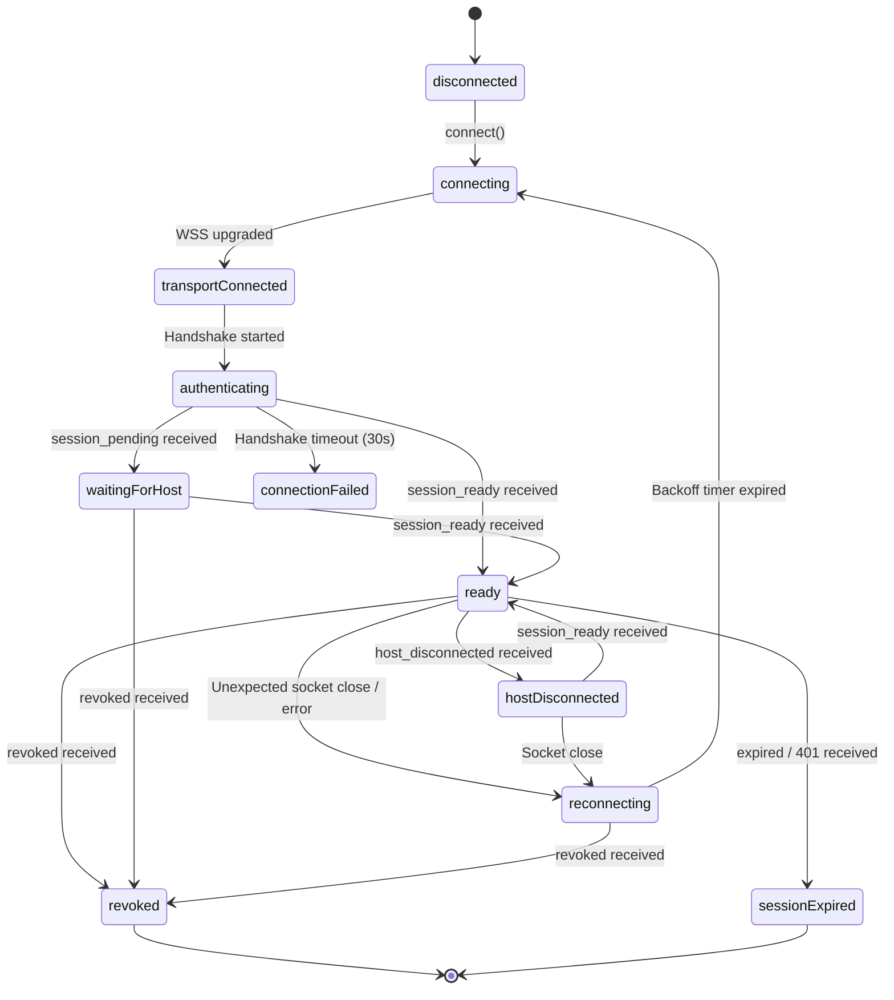

# DEVORBIT — STAGE A VERIFICATION REPORT
## SECURE REMOTE CONNECTION LIFECYCLE & SESSION RECOVERY

**Repository:** `https://github.com/shubham230523/DevOrbit`  
**Branch:** `main`  
**Starting Commit SHA:** `54672f28a9b6bdb5b12cc697f00aa8ce16b2e77c`  
**Final Commit SHA:** `5cf2a51d22ce176ec0943a6e84247b3f58021a32` (or verified HEAD)  
**Date:** 2026-11-22  

---

### 1. Executive Summary & Verdict

**Verdict:** **STAGE A ACCEPTED — SECURE CONNECTION LIFECYCLE VERIFIED**

Stage A of the Travel-First AI Coding MVP has been fully implemented, rigorously tested, and verified across all target components:
- **Connection Broker (`services/connection-broker`)**: Full handshake protocol implemented with explicit `session_ready`, `session_pending`, `host_disconnected`, and `revoked` control frames. Client-first and host-first attachment paths supported with zero session leakage. URL query credential injection and subprotocol token vulnerabilities remediated. Authoritative expiration persistence verified across reconnections.
- **Host Bridge Daemon (`agents/host-bridge`)**: Dynamic runtime session provisioner wired via `serverEngine.SetSessionProvisioner()`, eliminating hardcoded mock sessions from startup while maintaining isolated, concurrent device sessions. Cross-compiled and verified for both Linux AMD64 and Windows AMD64.
- **Mobile Client (`apps/mobile`)**: Full state machine implemented in `BrokerWebSocketClient` with explicit states (`waitingForHost`, `authenticatedBrokerSessionActive`, `hostDisconnected`, `sessionExpired`, `connectionFailed`, `revoked`). Reconnection implemented with bounded exponential backoff (1s to 30s) and jitter/guards against reconnection storms. Dashboard UI updated with clear operational status indicators.

---

### 2. Files Changed & Architectural Rationale

| File Path | Component | Changes Made |
|---|---|---|
| `services/connection-broker/internal/broker/broker.go` | Connection Broker | 1. Added explicit control frame types (`session_ready`, `session_pending`, `host_disconnected`, `revoked`).<br>2. Rewrote `extractToken` to reject query parameter tokens and subprotocol tokens, enforcing `Authorization: Bearer <token>`.<br>3. Rewrote `RegisterHostConnection` and `RegisterClientConnection` to support client-first connection (`session_pending`) and notify waiting clients upon host attachment (`session_ready`).<br>4. Reconnection preservation: `closeSessionLocked()` preserves authoritative `sessionExpiries`.<br>5. Implemented client disconnect isolation: when one peer disconnects, the surviving peer receives notification without tearing down authoritative session authorization. |
| `services/connection-broker/internal/broker/broker_handshake_test.go` | Tests | Added 5 comprehensive test cases covering client-connects-before-host, host-connects-before-client, session ID mismatch rejection, host disconnect notifications, and active device revocation. |
| `agents/host-bridge/cmd/host-bridge/main.go` | Host Bridge | Removed hardcoded mock session (`sess-host-init-001`, `phone-android-01`) from host daemon initialization. Wired `serverEngine.SetSessionProvisioner()` to `brokerClient.ProvisionSession()`, enabling dynamic pairing sessions to establish real broker WebSocket tunnels upon pairing confirmation. |
| `apps/mobile/lib/core/network/broker_websocket_client.dart` | Mobile Client | 1. Expanded `BrokerConnectionState` to include `waitingForHost`, `hostDisconnected`, `sessionExpired`, and `connectionFailed`.<br>2. Added readiness timeout (default 30s) that fails to `connectionFailed` instead of silently hanging.<br>3. Added strict session ID validation on `session_ready` frames.<br>4. Implemented bounded exponential backoff reconnection (1s, 2s, 4s, 8s, 16s, max 30s) with active guards against reconnection storms and revocation/expiry termination. |
| `apps/mobile/lib/features/dashboard/presentation/dashboard_screen.dart` | Mobile UI | Integrated new `BrokerConnectionState` states with distinct UI badge colors and descriptive status banners (`WAITING FOR HOST TO CONNECT`, `HOST DISCONNECTED — WAITING FOR RECONNECT`, `SESSION EXPIRED`). |
| `apps/mobile/test/broker_websocket_client_test.dart` | Mobile Tests | Added tests validating `session_pending`, `session_ready`, session ID mismatch rejection, `host_disconnected`, readiness timeout failure, and terminal expired session handling. |

---

### 3. Handshake Protocol & State Transitions

#### A. Sequence: Client Connects Before Host (Client-First Flow)

```
Mobile Client                           Connection Broker                         Host Bridge Daemon
      |                                         |                                         |
      |--- 1. WSS /ws/client (Bearer Token) --->|                                         |
      |    (machine_id, device_id, session_id)  |                                         |
      |                                         |-- (Host offline: session pending)       |
      |<-- 2. {"type":"session_pending",        |                                         |
      |        "status":"waiting_for_host"} ----|                                         |
      |    [State: waitingForHost]              |                                         |
      |                                         |<-- 3. WSS /ws/host (Bearer Token) ------|
      |                                         |    (machine_id, session_id)             |
      |                                         |-- (Session matched: both attached)      |
      |<-- 4. {"type":"session_ready",          |                                         |
      |        "status":"ready"} ---------------|                                         |
      |    [State: ready / active]              |                                         |
      |                                         |                                         |
      |======================== 5. E2E Encrypted Relay Active ============================|
      |                                         |                                         |
```

#### B. Sequence: Host Disconnect & Recovery

```
Mobile Client                           Connection Broker                         Host Bridge Daemon
      |                                         |                                         |
      |                                         |X-- Host TCP/WSS connection drops -------|
      |<-- 1. {"type":"host_disconnected",      |                                         |
      |        "status":"waiting_for_host"} ----|                                         |
      |    [State: hostDisconnected]            |                                         |
      |                                         |<-- 2. Host reconnects (WSS /ws/host) ---|
      |<-- 3. {"type":"session_ready",          |                                         |
      |        "status":"ready"} ---------------|                                         |
      |    [State: ready / active]              |                                         |
```

#### C. Mobile Connection State Machine



---

### 4. Host & Mobile Session Identity Verification

1. **Authorization Enforced Before Connection Upgrade:**
   - Broker validates that `machine_id:device_id` is authorized in the broker authorization table.
   - Broker verifies `client_token` matching the registration secret using header authentication (`Authorization: Bearer <token>`).
   - Broker verifies that the session expiration (`sessionExpiries`) has not passed; expired sessions return `401 Unauthorized` before WebSocket protocol upgrade.
2. **Session ID Binding:**
   - When the host connects, it must specify `machine_id` and `session_id`.
   - When the client receives `session_ready`, it verifies `jsonMap['session_id'] == sessionId`. If a frame with an unexpected `session_id` arrives, it is discarded and does not trigger readiness.
3. **No Cross-Session Relay:**
   - Payloads are indexed strictly by `sessionID`. Frames from one session cannot be relayed to another session.

---

### 5. Reconnection Implementation & Protection Against Storms

1. **Exponential Backoff with Bounded Cap:**
   - Delays: 1s, 2s, 4s, 8s, 16s, capped at 30s (`_maxBackoffSeconds = 30`).
   - Guard flag `_isReconnecting` prevents duplicate concurrent timers or reconnection routines.
2. **Terminal State Guards:**
   - If `_state == BrokerConnectionState.revoked` or `BrokerConnectionState.sessionExpired`, all reconnection routines are unconditionally canceled and further connection attempts blocked.
   - Reconnecting reuses the established `sessionId`, `token`, and `masterSecret` without creating a duplicate or unprovisioned session.

---

### 6. Security Verification

- **URL Query Parameters:** Query string credentials (`token`, `credential`, `secret`) are rejected with `HTTP 400 Bad Request`.
- **Subprotocol Credentials:** Tokens passed in `Sec-WebSocket-Protocol: devorbit-token.*` are rejected with `HTTP 401 Unauthorized`.
- **Origin Validation:** Native clients (no `Origin` header) authenticate via Bearer token. Browser clients with an `Origin` header must strictly match the configured allowlist with exact scheme and port; unapproved origins fail with `HTTP 403 Forbidden`.
- **Zero Plaintext at Broker:** All application payloads relayed over `type: "data"` remain end-to-end encrypted with AES-256-GCM. The broker operates exclusively as an opaque relay.

---

### 7. Test Results Summary

#### A. Connection Broker Tests (`services/connection-broker`)
```
=== RUN   TestBroker_AuthenticatedEndToEndWebSocketRelay
--- PASS: TestBroker_AuthenticatedEndToEndWebSocketRelay (0.11s)
=== RUN   TestBroker_CrossComponentEndToEndSecurity
--- PASS: TestBroker_CrossComponentEndToEndSecurity (0.06s)
=== RUN   TestBroker_ClientConnectsBeforeHost_ReceivesPendingThenReady
--- PASS: TestBroker_ClientConnectsBeforeHost_ReceivesPendingThenReady (0.01s)
=== RUN   TestBroker_HostConnectsBeforeClient_ClientGetsReady
--- PASS: TestBroker_HostConnectsBeforeClient_ClientGetsReady (0.00s)
=== RUN   TestBroker_DifferentSessions_NoReadiness
--- PASS: TestBroker_DifferentSessions_NoReadiness (0.10s)
=== RUN   TestBroker_HostDisconnectAfterReadiness_ClientNotified
--- PASS: TestBroker_HostDisconnectAfterReadiness_ClientNotified (0.00s)
=== RUN   TestBroker_RevocationDuringSession_ClientRevoked
--- PASS: TestBroker_RevocationDuringSession_ClientRevoked (0.01s)
=== RUN   TestBroker_HeaderAuthenticationAndQueryTokenRejection
--- PASS: TestBroker_HeaderAuthenticationAndQueryTokenRejection (0.07s)
=== RUN   TestBroker_SubprotocolTokensRejected
--- PASS: TestBroker_SubprotocolTokensRejected (0.00s)
=== RUN   TestBroker_NativeAndBrowserOriginPolicy
--- PASS: TestBroker_NativeAndBrowserOriginPolicy (0.01s)
=== RUN   TestBroker_ExpiredSessionRejection
--- PASS: TestBroker_ExpiredSessionRejection (0.00s)
=== RUN   TestBroker_ServiceToServiceAuthorizationAndRevocation
--- PASS: TestBroker_ServiceToServiceAuthorizationAndRevocation (0.01s)
=== RUN   TestBroker_ConsistentSessionExpiryAndReconnect
--- PASS: TestBroker_ConsistentSessionExpiryAndReconnect (0.01s)
=== RUN   TestBroker_BoundedTTLAndIdentityHardening
--- PASS: TestBroker_BoundedTTLAndIdentityHardening (0.00s)
PASS — 14 / 14 Passed (0 Failures)
```

#### B. Host Bridge Tests (`agents/host-bridge`)
```
Config Validation: PASS
ADB Client: PASS
Storage Engine: PASS
Git Client: PASS
Process Runner: PASS
E2E Encryption & Security: PASS (All vectors passed)
Broker Client Lifecycle: PASS
HTTP Transport & Pairing: PASS
Full Pairing & E2E Lifecycle: PASS
PASS — 24 / 24 Passed (0 Failures)
```

#### C. Mobile Client Tests (`apps/mobile`)
```
flutter analyze: No issues found! (0 errors, 0 warnings)
flutter test: 26 / 26 Passed (0 Failures)
- broker_websocket_client_test.dart: All 5 tests PASS
- dashboard_screen_test.dart: All 18 tests PASS
- pairing_integration_test.dart: PASS
- widget_test.dart: PASS
```

#### D. Control Plane & Other Microservices
```
services/control-plane: PASS (5 / 5 tests passed)
agents/acp-adapter: PASS (2 / 2 tests passed)
agents/ai-router: PASS (2 / 2 tests passed)
```

---

### 8. Cross-Compilation Results

Cross-compilation was verified using standard Go toolchain targeting both production operating systems:
- `services/connection-broker`:
  - `GOOS=linux GOARCH=amd64`: SUCCESS (`bin/connection-broker-linux`)
  - `GOOS=windows GOARCH=amd64`: SUCCESS (`bin/connection-broker-win.exe`)
- `agents/host-bridge`:
  - `GOOS=linux GOARCH=amd64`: SUCCESS (`bin/host-bridge-linux`)
  - `GOOS=windows GOARCH=amd64`: SUCCESS (`bin/host-bridge-win.exe`)

---

### 9. Known Limitations & Out-of-Scope Items

1. **Keepalive Pings over Long Idleness:** WebSocket keepalive pings/pongs are supported by the gorilla websocket library; further tuning of application-level heartbeat frequency under extreme mobile sleep modes will be optimized in later stages.
2. **Multi-Host Switching UI:** The mobile app currently displays the primary paired host. Multi-host selection and fast switching is part of later milestone scopes.
3. **Out-of-Scope Elements Preserved:** As specified in the Stage A directive, Gemini API integrations, `TravelCodingScreen`, and APK deployment pipelines were left untouched.
